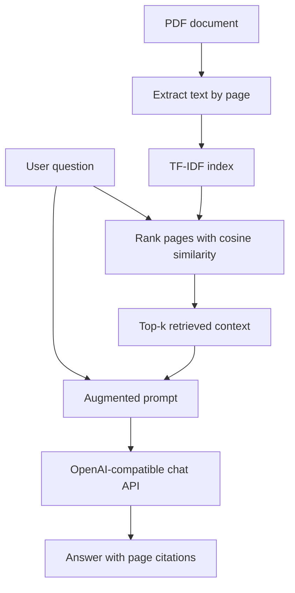

# PDF RAG QA — Retrieval-Augmented Question Answering

A Python command-line tool that searches a text-based PDF, retrieves relevant pages, builds an augmented prompt from the user's question and retrieved context, and asks an OpenAI-compatible LLM to answer with page citations.

> **Project status:** The retrieval and prompt-building components have offline tests. Generating a response requires a valid API key or a running local OpenAI-compatible model server.

## Features

- Extracts text and preserves PDF page numbers with `pypdf`.
- Retrieves relevant pages using TF-IDF (unigrams and bigrams) and cosine similarity.
- Prints retrieved page numbers and similarity scores.
- Prints the **full augmented prompt** sent to the model.
- Prints the LLM-generated answer, instructed to stay grounded in the retrieved context and cite page numbers.
- Configurable PDF path, model, number of retrieved pages, and context length.
- Keeps credentials out of source control using `.env` and `.gitignore`.
- Includes offline unit tests and a GitHub Actions workflow.

## Architecture



## Requirements

- Python 3.10 or newer recommended.
- A PDF with selectable text. Scanned/image-only PDFs need OCR before use.
- An API key for a compatible LLM provider, or a running local OpenAI-compatible model server.

## Setup on Windows (PowerShell)

Open PowerShell in the extracted project directory and run:

```powershell
py -m venv .venv
.\.venv\Scripts\Activate.ps1
python -m pip install --upgrade pip
pip install -r requirements.txt
Copy-Item .env.example .env
```

If PowerShell blocks virtual-environment activation, either use a terminal where scripts are permitted or run the environment's Python directly with `.\.venv\Scripts\python.exe`.

Edit `.env` and set your own provider API key, base URL, and model. Do not commit `.env`.

## Setup on macOS / Linux

```bash
python3 -m venv .venv
source .venv/bin/activate
python -m pip install --upgrade pip
pip install -r requirements.txt
cp .env.example .env
```

Then edit `.env` with your own provider settings.

## Configure the LLM

The included `.env.example` is prefilled with an OpenRouter-style configuration:

```dotenv
LLM_API_KEY=your_api_key_here
LLM_BASE_URL=https://openrouter.ai/api/v1
LLM_MODEL=openai/gpt-oss-120b
```

Use a model available to your provider account. You can change these values without editing Python source.

Other supported configurations:

- **Groq:** set `LLM_BASE_URL=https://api.groq.com/openai/v1` and choose a model currently available to your account.
- **OpenAI:** comment out `LLM_BASE_URL`, set `LLM_API_KEY`, and use a model available to your account (for example `gpt-4o-mini`).
- **Local Ollama:** start Ollama, pull a compatible model, set `LLM_BASE_URL=http://localhost:11434/v1`, `LLM_MODEL` to the installed model name, and leave `LLM_API_KEY` empty. This uses local inference; availability depends on the installed Ollama version/model.

Provider model IDs and availability can change. Consult your provider's current model list if a model is rejected.

## Run the CLI

From the project root, with the virtual environment active and `.env` configured:

```powershell
python pdf_search.py --pdf book.pdf --query "What is recursion?"
```

Example with retrieval options:

```powershell
python pdf_search.py --pdf book.pdf --query "Explain dictionaries" --top-k 4 --max-chars 2500
```

Options:

| Option | Description | Default |
|---|---|---|
| `--pdf` | Path to a text-based PDF | `book.pdf` |
| `--query` | Question to answer (required) | — |
| `--top-k` | Maximum relevant pages to retrieve | `3` |
| `--max-chars` | Maximum characters per retrieved page in the prompt; `0` means unlimited | `3000` |
| `--model` | Override the configured model for this run | Value of `LLM_MODEL` |

The terminal output contains three useful parts: retrieved page references and similarity scores, the augmented prompt (including the actual retrieved text), and the generated response. See [docs/sample-output.txt](docs/sample-output.txt) for an illustrative output template (not a captured execution log).

## Run tests without calling an LLM

Install development dependencies and run the offline tests:

```powershell
pip install -r requirements-dev.txt
python -m pytest -q
```

These tests check retrieval ranking, augmented prompt construction, and PDF text extraction. They do not call an external model API.

## Troubleshooting

- **`LLM_API_KEY is missing`:** set it in `.env`, or configure a local server URL.
- **Authentication / quota error:** check the key, account quota, and provider endpoint.
- **Model not found:** use a model ID supported by your provider.
- **Connection refused:** check the base URL or start your local model server.
- **No selectable text:** this tool does not perform OCR; OCR the PDF first.
- **No relevant text found:** try a question using terms likely to occur in the document.
- **Page citation looks wrong:** inspect the retrieved context and verify the answer against the PDF. The LLM can still make mistakes.

## Limitations and design choices

- Retrieval uses lexical TF-IDF, not dense embedding-based semantic search. It can miss relevant content phrased with different vocabulary.
- Each non-empty PDF page is treated as one retrieval chunk; long pages are truncated by `--max-chars` unless set to `0`.
- The model is instructed to answer from retrieved context, but this does not guarantee factual correctness. Check the cited pages.
- For hosted models, retrieved PDF text is sent to the provider. Do not use sensitive documents with a hosted provider unless permitted.

## Security checklist before publishing

- Keep `.env` out of Git. `.gitignore` excludes it and local environments.
- Commit `.env.example` only; it must contain placeholders, never a real key.
- If a key was previously committed, rotate/revoke it. Deleting it from the latest commit does not remove it from Git history.
- Do not include private or copyrighted PDFs unless you have permission to redistribute them. Replace `book.pdf` with a public-domain or self-created sample if its redistribution rights are unclear.

## License

The application code is licensed under MIT; see [LICENSE](LICENSE). The included sample `book.pdf` is *Think Python*, 2nd Edition, by Allen B. Downey and is distributed under the separate Creative Commons Attribution-NonCommercial 3.0 license described in [BOOK-LICENSE.txt](BOOK-LICENSE.txt). Do not assume the code license applies to the book.
